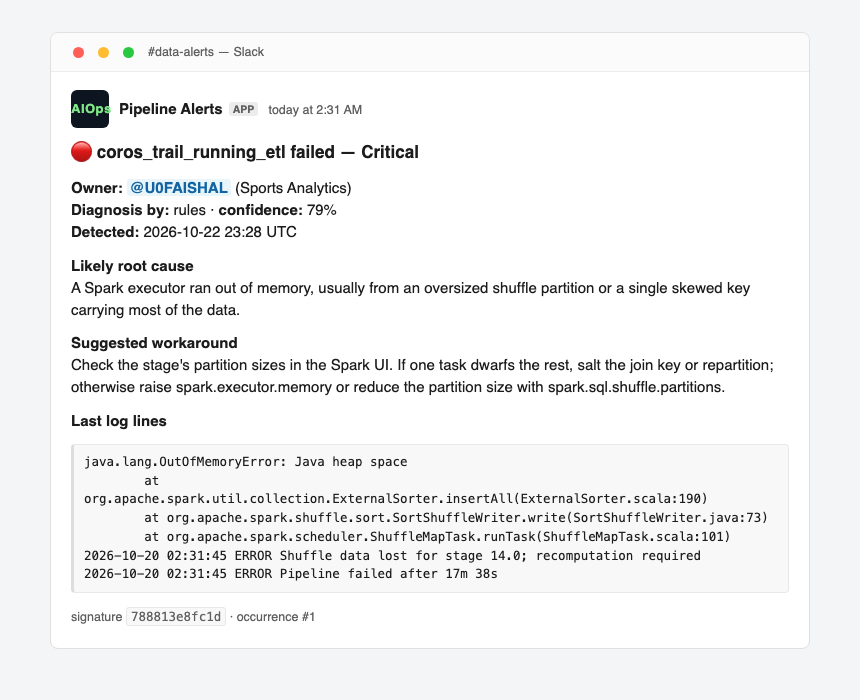

# AIOps Pipeline Alerts
[](https://github.com/faishalnuruz/aiops-pipeline-alerts/actions/workflows/ci.yml) [](LICENSE)

A failed pipeline should page exactly one person, once, with a diagnosis and a fix.

Today most teams get the opposite: a raw stack trace pasted into a shared channel, nobody sure
whose pipeline broke, the same failure repeated twenty times an hour, and an on-call engineer
reading logs before they can even start fixing anything. This project turns that failure log
into one routed, de-duplicated, human-readable alert.



## What it does

1. **Prepares the log** — tails it and redacts credentials, tokens, JWTs, AWS keys, and
   connection strings before anything leaves the machine.
2. **Diagnoses the failure** — a language model when configured, a deterministic rule engine
   otherwise. The rule engine is not a stub: it ships eight known failure signatures with the
   workaround a senior engineer would suggest first.
3. **Distrusts the model** — answers must be strict JSON matching a schema, get exactly one
   repair attempt, and fall back to the rules if they still fail. The message always says which
   path produced the diagnosis and how confident it is.
4. **Routes to the owner** — from configuration, by exact name or pipeline prefix, with an
   on-call fallback so an alert never lands where nobody is responsible.
5. **Groups repeats** — the same failure inside a cooldown window is reported as a repeat, so a
   flapping pipeline pages once instead of fifty times. A notification that *failed* to deliver
   does not start a window, so a broken webhook cannot silently swallow the next failure.

## Try it in one command

No API key, no Slack workspace, no network needed:

```bash
python3 -m venv .venv
.venv/bin/pip install -e '.[dev]'
.venv/bin/python -m aiops_alerts.cli --job coros_trail_running_etl --log-file samples/logs/spark_oom.log
```

```text
[dry-run] coros_trail_running_etl -> <@U0FAISHAL> (critical, rules, 79%): A Spark executor ran out of memory, usually from an oversized shuffle partition or a single skewed key carrying most of the data.
  - redacted 3 credential or token value(s) before triage
  - triaged by rules (signature: spark_oom)
  - routed to U0FAISHAL via exact match
  - not delivered: dry run
```

Run the same command again and the second (and twentieth) occurrence is grouped instead of
paged. Two more sample logs show routing and severity:

```bash
.venv/bin/python -m aiops_alerts.cli --job olist_orders_ingest --log-file samples/logs/db_credentials.log
.venv/bin/python -m aiops_alerts.cli --job olist_gold_daily_sales --log-file samples/logs/schema_change.log
```

The first routes to `U0COMMERCE` as `critical` (a rejected credential), the second routes to the
same owner by prefix as a `warning` (schema drift). The full transcript, including the grouping
run, is committed in [`docs/evidence/demo-offline.md`](docs/evidence/demo-offline.md).

## Using the model

The LLM path is optional and defensive. Set a key and add `--use-llm`:

```bash
export GEMINI_API_KEY=...
.venv/bin/python -m aiops_alerts.cli --job coros_trail_running_etl \
  --log-file samples/logs/spark_oom.log --use-llm
```

The contract the model must satisfy:

```json
{
  "root_cause": "at most two sentences, naming the mechanism",
  "workaround": "concrete steps an on-call engineer can run now",
  "severity": "critical | warning | info",
  "confidence": 0.0
}
```

Anything else — prose, a missing key, an invented severity, a confidence of `4.5` — is rejected.
The model gets one repair attempt; after that the rule engine answers and the message records
`Diagnosis by: rules`, so a reader always knows whether a human-authored rule or a model wrote
it.

## Send it to Slack

```bash
export SLACK_WEBHOOK_URL=https://hooks.slack.com/services/T.../B.../X...
.venv/bin/python -m aiops_alerts.cli --job coros_trail_running_etl \
  --log-file samples/logs/spark_oom.log --send
```

Dry run is the default on purpose: print the payload, review it, then send. To preview a payload
as a rendered message, `tools/preview_slack.py payload.json out.html`.

## Wire it into Airflow

[`dags/example_airflow_dag.py`](dags/example_airflow_dag.py) shows the whole integration:

```python
default_args = {"on_failure_callback": on_failure, "retries": 2}

def on_failure(context):
    result = handle_failure(
        job_name=context["dag"].dag_id,
        log_text=_read_task_log(context),
        webhook_url=os.environ.get("SLACK_WEBHOOK_URL"),
        dry_run=os.environ.get("ALERTS_DRY_RUN", "0") == "1",
        offline=not os.environ.get("GEMINI_API_KEY"),
    )
    print(result.summary)
```

Airflow is not a dependency of this package and the test suite never imports it, so the library
stays installable and testable anywhere.

## Routing configuration

`config/pic_mapping.json` maps pipeline names to owners. Exact match wins, then the longest
prefix, then `default`:

```json
{
  "default": {"slack_id": "U0ONCALL", "team": "Data Platform on-call", "oncall": true},
  "pipelines": {
    "coros_trail_running_etl": {"slack_id": "U0FAISHAL", "team": "Sports Analytics"},
    "olist_": {"slack_id": "U0COMMERCE", "team": "Commerce Analytics"}
  }
}
```

## Known failure signatures

| Signature | Typical log | Severity |
| --- | --- | --- |
| `spark_oom` | `OutOfMemoryError`, container killed by YARN | critical |
| `database_auth` | `password authentication failed`, `401`, `permission denied` | critical |
| `schema_change` | `AnalysisException`, `cannot resolve`, `Unknown column` | warning |
| `skew_or_shuffle_failure` | `FetchFailedException`, shuffle fetch failure | critical |
| `network_timeout` | `TimeoutError`, `Connection reset by peer` | warning |
| `rate_limit` | `429`, `quota exceeded` | warning |
| `disk_space` | `No space left on device` | critical |
| `code_bug` | `TypeError`, `KeyError`, `AttributeError` | warning |

An unmatched log is reported as `unclassified` with low confidence and an honest "this needs a
human look" workaround, rather than a confident guess.

## Tests

```bash
.venv/bin/python -m pytest -q     # 48 passed
.venv/bin/ruff check .
```

They cover log tailing and redaction (including the guarantee that secrets never reach the
payload), signature stability across runs, rule matching, model-answer validation and repair,
the fallback path when the model is unavailable, routing precedence, grouping windows, Slack
Block Kit structure, and end-to-end runs over the sample logs with a fake model and webhook.

## Deliberate limitations

- The rule engine knows eight signatures; anything else is `unclassified` by design.
- Grouping keys on `job + normalized error line`, so two different pipelines failing for the
  same upstream reason will each page once.
- Messages are posted by incoming webhook, which cannot open a thread, so grouped repeats are
  reported in the channel rather than replied to. Threading needs a bot token.
- The live Gemini call is not exercised in CI (no key); the transport is injected in tests, so
  the parsing, repair, and fallback logic is covered even though the network call is not.
- There is no durable queue: if the webhook is down the alert is lost, but because a failed
  delivery does not start a grouping window, the next failure pages again.

## Next

1. **Auto-ticketing** — create a Jira issue assigned to the resolved owner with the diagnosis as
   the description.
2. **Auto-remediation** — open a pull request for the trivial class of failures (a renamed
   column, a stale config value) and link it in the alert.
3. **Route by severity** — page the on-call rotation only for `critical`, batch `warning` into a
   digest.
4. **Learn signatures** — mine resolved incidents so the rule engine grows from history instead
   of from my imagination.
